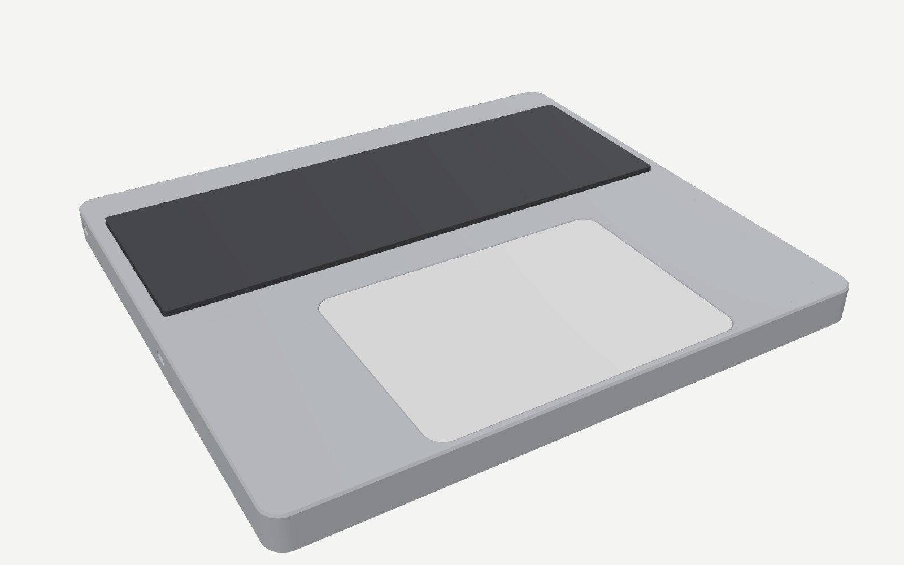

# joropad

Razer Joro + Apple Magic Trackpad（USB-C）组合成的笔记本式主板，用 3D 打印制作。顶面完全水平，触控板玻璃比面板低 0.3 mm，两个设备都从底面装入，两个 USB-C 充电口在左侧面。



当前版本是 **v9**：用 build123d（OpenCascade）建模，可以直接输出 STEP。

- 改了什么、为什么改：[docs/v9_notes.md](docs/v9_notes.md)
- 上一版的交接文档：[docs/v8_handoff.md](docs/v8_handoff.md)

## 成品文件

| 文件 | 内容 |
|---|---|
| `out/print/joro_deck_v9.3mf` | 8 块打印件（上壳 4 块，底盖 4 块），已经摆好打印朝向，每块不超过 250 × 250 |
| `out/print/joro_deck_v9_fit_test.3mf` | 4 个试配件，**建议先打这个** |
| `out/print/stl/*.stl` | 和上面相同的零件，每块一个 STL |
| `out/joro_deck_v9_step.zip` | STEP 文件，可在 Shapr3D 中编辑：上壳、底盖、带设备包络的装配体，以及 8 块分块（装配坐标） |
| `docs/check_v9.txt` | `check.py` 的完整校验报告 |

## 重新生成

需要 Python 3.10 以上。

```bash
pip install -r requirements.txt
cd cad
python params.py     # 打印尺寸摘要
python check.py      # 干涉、间隙、分块尺寸、螺丝柱归属等检查，有失败时返回非零
python build.py      # 写出 ../out（约 50 秒）
```

调参数时可以直接改 `cad/params.py`，也可以只在命令行临时覆盖：

```bash
DECK_PARAMS='{"SEAM_STYLE":"dovetail","KB_SKIN":0.8}' python build.py
```

预览图由 `tools/make_images.py` 生成。它需要 node、playwright，并且要在 `RENDER_DIR` 里执行过 `npm install three`。

## 目录

```
cad/params.py     全部参数和派生布局（标了 MEASURE 的需要实测）
cad/deck.py       上壳、底盖、设备包络、试配件
cad/split.py      分块（直缝 / 燕尾缝）和打印朝向
cad/check.py      设计校验
cad/build.py      导出 STEP / STL / 3MF
tools/            渲染工具
legacy_v8/        v8 的 SDF + marching cubes 管线（仅作参考）
```
