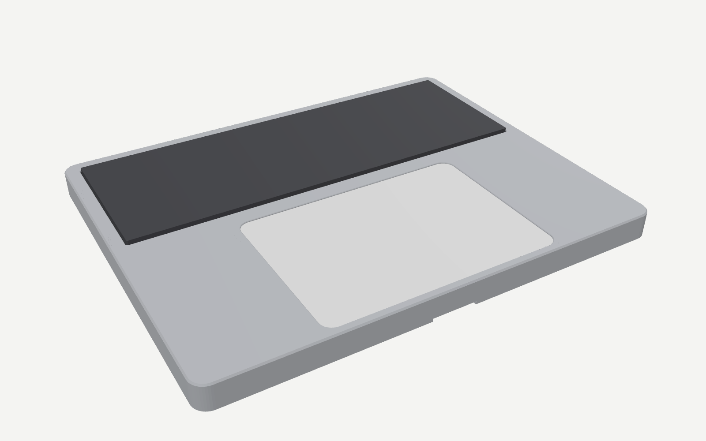
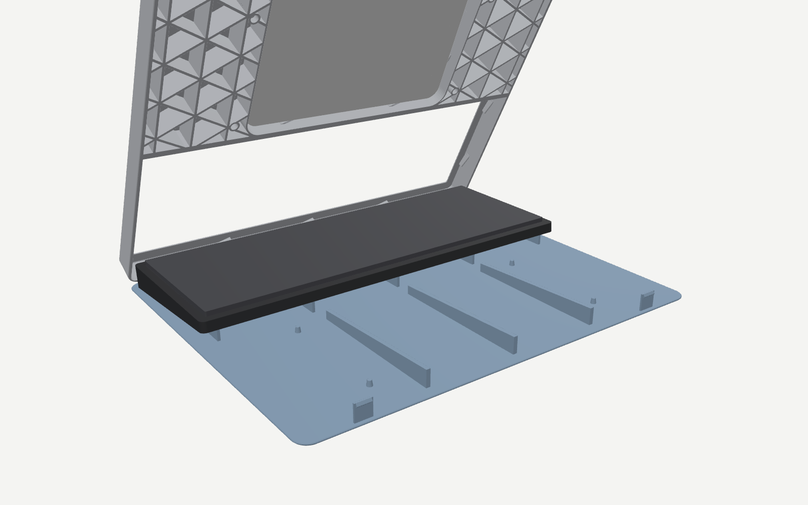

# joropad

Razer Joro + Apple Magic Trackpad（USB-C）组合成的笔记本式主板，用 3D 打印制作。顶面完全水平，只露出键帽；触控板开口四周有 0.8 mm 的薄边压在玻璃边缘上方，倒过来也掉不出来（玻璃比面板低约 1 mm）。整个上壳是一个卡扣固定的盖子，掀开就能拿出键盘和触控板去充电。只有两个打印件，不需要螺丝、磁铁、泡棉、胶水等任何额外材料。




用 build123d（OpenCascade）建模，可以直接输出 STEP。有两种生成方式：

- **service（默认）**：交给打印服务商一次成型。上壳、底盘各打一整块（JLC3DP MJF 尼龙 PA12），底盘是全封闭的实心板。
  - 上壳靠前面 2 个打印卡扣和后边 4 个挂钩扣在底盘上，没有螺丝，也没有充电口。
  - 键盘和触控板由上壳里打印出来的弹片从两边夹住、自动居中，弹片同时吃掉服务商的打印公差。
  1. 先按 [实测表](docs/measure_sheet.md) 量好设备尺寸。
  2. 下单和装配看 [下单与装配指南](docs/order_guide.md)。
  3. **实测值没确认之前，程序不会生成下单文件。**
- **fdm**（v9）：用自己的 256 mm 打印机打，拆成 8 块，带两个 USB-C 充电口，用螺丝固定。见 [docs/v9_notes.md](docs/v9_notes.md)。`out/print/` 和 `out/joro_deck_v9_step.zip` 是 v9 按估计值生成的快照。

上一版的交接文档：[docs/v8_handoff.md](docs/v8_handoff.md)

## 文件

**服务商版**：实测值确认后，由 `python build.py` 生成到 `out/service/`，内容包括：
- `top_case.stl/.step`（上壳）、`bottom_cover.stl/.step`（底盘）
- `assembly_reference.step`（含设备包络）
- `订单说明.txt`

目前还没有生成，因为要等实测值。

**v9 FDM 快照**（按估计值生成，自己打印用）：

| 文件 | 内容 |
|---|---|
| `out/print/joro_deck_v9.3mf` | 8 块打印件（上壳 4 块，底盖 4 块），已经摆好打印朝向，每块不超过 250 × 250 |
| `out/print/joro_deck_v9_fit_test.3mf` | 4 个试配件，**建议先打这个** |
| `out/print/stl/*.stl` | 和上面相同的零件，每块一个 STL |
| `out/joro_deck_v9_step.zip` | STEP 文件，可在 Shapr3D 中编辑：上壳、底盖、带设备包络的装配体，以及 8 块分块（装配坐标） |
| `docs/check_v9.txt` | `check.py` 的完整校验报告 |

## 重新生成

需要 Python 3.10 以上。

```bash
pip install -r requirements.txt
cd cad
python params.py              # 打印尺寸摘要
python check.py               # 干涉、间隙、公差余量、打印尺寸等检查，有失败时返回非零
python build.py               # 下单文件 -> ../out/service（要求 measurements.json 里 confirmed 为 true）
python build.py --preview     # 用估计值预览 -> ../out/service_preview（不要拿去下单）
DECK_PROFILE=fdm python build.py   # v9 的 8 块分块版本
```

设备尺寸全部放在 `cad/measurements.json`，编号和实测表一一对应。

调参数时可以直接改 `cad/params.py`，也可以只在命令行临时覆盖：

```bash
DECK_PARAMS='{"SEAM_STYLE":"dovetail","KB_SKIN":0.8}' python build.py
```

预览图由 `tools/make_images.py` 生成。它需要 node、playwright，并且要在 `RENDER_DIR` 里执行过 `npm install three`。

## 目录

```
cad/measurements.json  设备实测值（编号对应 docs/measure_sheet.md）
cad/params.py     全部参数和派生布局（service / fdm 两套）
cad/deck.py       上壳、底盖、设备包络、试配件
cad/split.py      分块（直缝 / 燕尾缝）和打印朝向
cad/check.py      设计校验
cad/build.py      导出 STEP / STL / 3MF
tools/            渲染工具、实测示意图
legacy_v8/        v8 的 SDF + marching cubes 管线（仅作参考）
```
