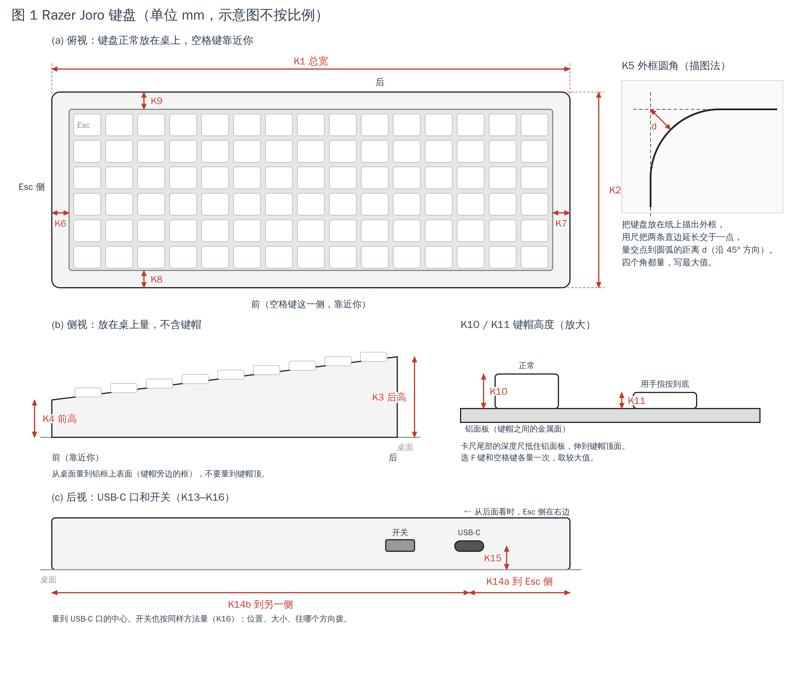
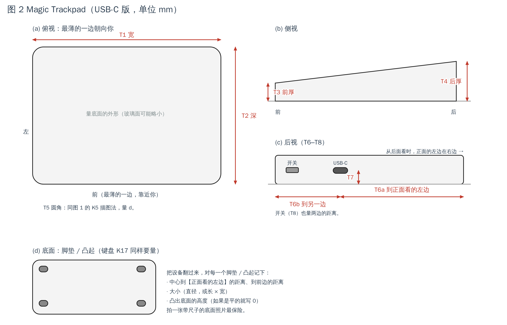
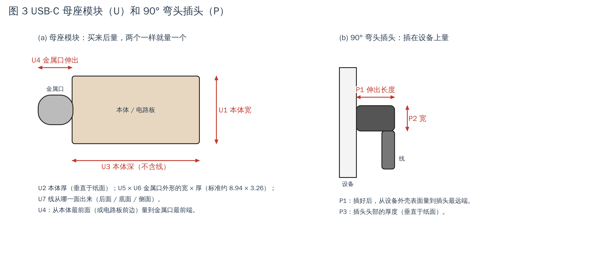

# 实测表（键盘、触控板、线材到货后填写）

因为是交给服务商一次打印成型，**图纸里每一个和设备配合的尺寸都要用真实测量值**。按这张表量完，把文末的"回复模板"填好发给我。我把数字填进 `cad/measurements.json`，跑完全部检查后再出最终文件。数字没确认之前，程序会拒绝生成下单文件。

## 量之前

- **工具：数显游标卡尺**（0–150 mm，精度 0.01 mm，几十元）。用直尺量不出 0.1 mm 的精度，只靠直尺很难一次做对。另外准备一把 30 cm 钢尺和一张 A4 纸。
- **精度**：写到 0.1 mm。每个尺寸量 2 次，两次差别超过 0.2 mm 就再量一次。
- **方向约定**：
  - 键盘：空格键靠近你的一边是"前"，**Esc 键所在的一侧叫"Esc 侧"**。不说左右，避免把键盘翻过来时搞反。
  - 触控板：最薄的一边是"前"。"左"指**正面朝向你时的左边**。
- 带"a / b"的项目要从两头各量一次。我会用"a + b + 口宽 ≈ 总宽"来核对有没有量反。

## 图 1　键盘 Razer Joro



| 编号 | 量什么 | 怎么量 | 当前估计值 | 实测值 |
|---|---|---|---|---|
| K1 | 总宽 | 卡尺或钢尺，量最宽处 | 298 | |
| K2 | 深度（底面） | 底面前缘到后缘 | 112 | |
| K2b | 深度（顶面） | 顶面铝框前沿到后沿 | 约 112.4 | |
| K3 | 后端高度 | 放在桌上，桌面到铝框上表面，**不含键帽** | 16.5 | |
| K4 | 前端高度 | 同上，量前端 | 约 7.5 | |
| K5 | 外框圆角 d | 见图 1 右上的描图法，四个角取最大值 | 约 1.7 | |
| K6 | 键区边距：Esc 侧 | 外框边缘到最外侧键帽边缘 | 6 | |
| K7 | 键区边距：另一侧 | 同上 | 6 | |
| K8 | 键区边距：前（空格键侧） | 同上 | 6 | |
| K9 | 键区边距：后 | 同上 | 6 | |
| K10 | 键帽高出铝面板 | 卡尺深度尺抵住键帽之间的铝面，量到键帽顶。F 键和空格键各量一次 | 3.5 | |
| K11 | 按到底后键帽高出铝面板 | 一手把键按到底，另一手量 | 1.9 | |
| K12 | 铝框上表面比键帽之间的铝面高多少 | 一样平就写 0 | 0 | |
| K13 | USB-C 口在哪个面 | 背面 / Esc 侧面 / 另一侧面 | 背面（评测说法不一） | |
| K14a / K14b | USB-C 口中心到 Esc 侧边缘 / 到另一侧边缘 | 看图 1(c) | ? | |
| K15 | USB-C 口中心离桌面的高度 | | ? | |
| K16 | 每个开关的位置 | 在哪个面、中心到两侧的距离（a / b）、离桌面高度、开关大小、往哪个方向拨 | ? | |
| K17 | 底面脚垫 / 凸起 | 每个脚垫：中心到 Esc 侧边缘的距离、到前边的距离、大小、凸出高度 | ? | |

## 图 2　Magic Trackpad（USB-C）



| 编号 | 量什么 | 怎么量 | 当前估计值 | 实测值 |
|---|---|---|---|---|
| T1 | 宽（底面） | | 160 | |
| T2 | 深（底面） | | 114.9 | |
| T3 | 前端厚 | 放在桌上，桌面到玻璃面 | 4.9 | |
| T4 | 后端厚 | 同上 | 10.9 | |
| T5 | 外形圆角 d | 同 K5 的描图法 | 约 3.7 | |
| T6a / T6b | USB-C 口中心到正面看的左边 / 到另一边 | 看图 2(c) | 116 / 44 | |
| T7 | USB-C 口中心离桌面的高度 | | ? | |
| T8a / T8b | 电源开关中心到正面看的左边 / 到另一边 | | 154 / 6 | |
| T9 | 底面脚垫 / 凸起 | 同 K17 | ? | |
| T10 | 玻璃面的宽和深 | 只量上表面的玻璃（如果和底面一样大，写"同 T1 / T2"） | ? | |

## 图 3　USB-C 母座模块和 90° 弯头插头



| 编号 | 量什么 | 当前估计值 | 实测值 |
|---|---|---|---|
| U1 | 母座端本体宽（和开口长边同方向） | 11 | |
| U2 | 母座端本体厚 | 6 | |
| U3 | 母座端本体长（不含线） | 14 | |
| U4 | 金属口伸出本体前端的长度（和本体齐平就写 0） | 1.2 | |
| U5 × U6 | 金属口外形的宽 × 厚 | 8.94 × 3.26 | |
| U7 | 线从本体哪一面出来 | 后面 | |
| U8 | 有没有固定耳朵、法兰或卡扣（有的话量孔距和外形） | 无 | |
| P1 | 弯头插好后，从设备外壳表面伸出的长度 | 9 | |
| P2 / P3 | 弯头头部的宽 / 厚 | 12 / 6.5 | |
| P4 | 弯头方向 | 侧弯 | |
| P5 | 线的外径 | 3.5 | |

## 照片（每张旁边放一把尺子）

1. 键盘正上方俯拍（整把键盘拍全）
2. 键盘背面平视（USB-C 口和开关都要拍到）
3. 键盘底面
4. 键盘侧面平视（能看出楔形）
5. 触控板背面平视、触控板底面
6. 母座模块：正面、侧面各一张
7. 弯头插头插在键盘上、插在触控板上各一张

## 现在就可以下单的东西

母座和弯头线到货后也要量，所以请和键盘、触控板一起买。

| 东西 | 规格 | 数量 | 淘宝搜索参考 |
|---|---|---|---|
| 数显游标卡尺 | 0–150 mm | 1 | 数显游标卡尺 150mm |
| USB-C 延长线（一端母座，一端 90° 弯头公头） | 母座端越小越好（宽 ≤ 12、厚 ≤ 7、长 ≤ 18 mm），**最好是母座焊在小电路板上、金属口露在板子前面**的那种；弯头选**侧弯**（线从侧面出，不要上下弯）；能充电也能传数据 | 2 根（一根 25 cm 给触控板，一根 30 cm 给键盘） | Type-C 母转公 90度 侧弯 延长线 母座 嵌入式 |
| 沉头自攻螺丝 | M3 × 8（ST3.0），十字沉头，头部直径约 6 mm | 30 颗（用 24 颗） | 沉头自攻螺丝 M3x8 |
| EVA 泡棉（单面背胶） | 1.0 mm 厚、1.5 mm 厚各一张 | 各 1 张 | EVA 单面背胶 泡棉 1mm / 1.5mm |
| 双面泡棉胶 | 1.0 mm 厚，宽 5–10 mm | 1 卷 | 双面泡棉胶 1mm |
| 塞尺 | 带 0.30 mm 片（装触控板时用来定 0.3 mm 下沉） | 1 | 塞尺 |
| 自粘橡胶脚垫 | 直径 10 mm，厚 1.5–2 mm | 4 | 自粘 硅胶脚垫 10mm |

如果买到的母座和上面的要求不一样（例如金属口和本体齐平、带耳朵），也没关系：照常量 U1–U8 并拍照，我按实物改卡座的结构。

## 回复模板（复制后填数字）

```
K1 =
K2 =        K2b =
K3 =        K4 =
K5 (d) =
K6 (Esc侧) =    K7 =    K8 (前) =    K9 (后) =
K10 =       K11 =       K12 =
K13 (口在哪个面) =
K14a (到Esc侧) =    K14b (到另一侧) =    K15 (高) =
K16 开关：
K17 脚垫：
T1 =   T2 =   T3 =   T4 =   T5 (d) =
T6a =  T6b =  T7 =
T8a =  T8b =
T9 脚垫：
T10 玻璃面 宽 × 深 =
U1 =  U2 =  U3 =  U4 =  U5 × U6 =  U7 =  U8 =
P1 =  P2 =  P3 =  P4 =  P5 =
```
