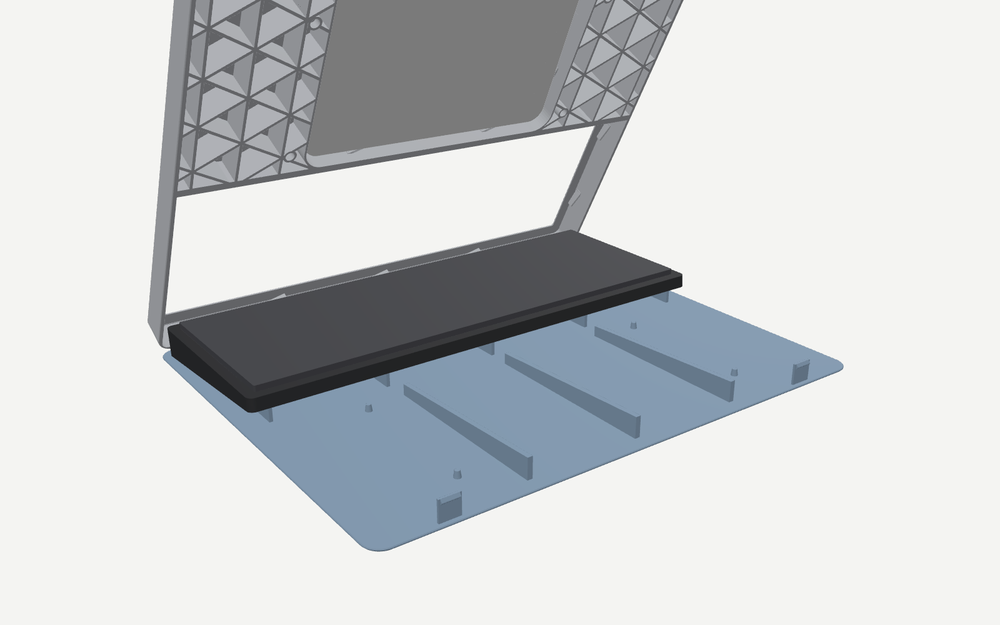
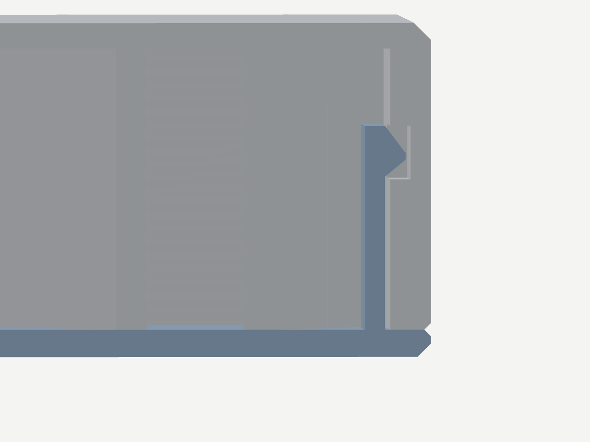
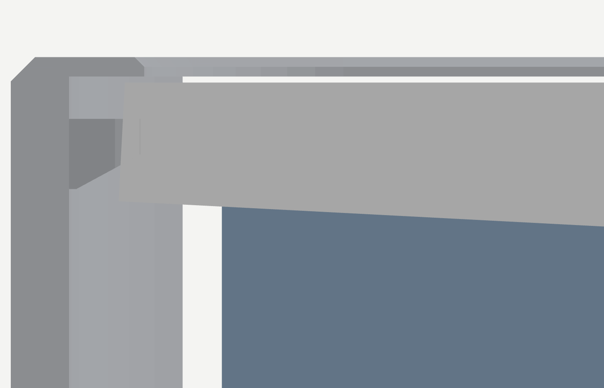
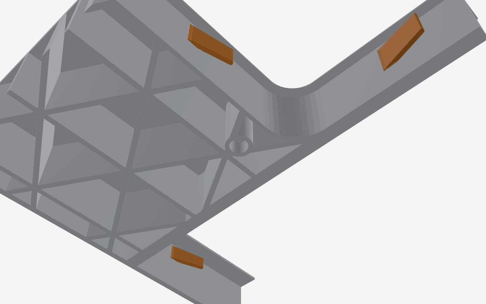

# 下单与装配指南（服务商一次成型版）

## 选哪家、选什么材料

**推荐：JLC3DP（嘉立创 3D 打印），MJF 尼龙 PA12（HP）。** 理由如下：

- **能整块打印**。MJF PA12 的最大打印尺寸是 370 × 276 × 360 mm（[JLC3DP 设计规范](https://jlc3dp.com/help/article/3D-Printing-Design-Guideline)）。上壳约 305 × 245 × 18，底盘约 305 × 245 × 10，都能一次打完，不需要拆成小块再拼接。
- **尼龙韧性好**。不怕磕碰，后部的挂钩也不容易断。
- **公差有余量**。官方公差是 100 mm 以内 ±0.3 mm，超过 100 mm 为 ±0.4%（[PA12-HP 材料页](https://jlc3dp.com/help/article/200-PA12-HP-Nylon)）。`check.py` 按这个最坏情况核算过：键帽、触控板、键盘四周都还留有间隙。

**为什么不用光敏树脂（SLA）**：树脂件更光滑，也更便宜，但比较脆，后部的挂钩和薄壁容易断；大面积的薄板放久了也可能翘曲。

## 下单步骤（你在澳洲）

前提：你已经把实测值发给我，我生成了 `out/service/`，并且 `check.py` 全部通过。

有两种下单方式，用的是同一套文件。

**方式 A（推荐）：在 JLC3DP 国际站直接下单，寄到澳洲**

工厂和国内是同一家，网站是英文的，结账时填澳洲地址即可，不需要转运。

1. 打开 jlc3dp.com，进入 3D Printing 的报价页面（Instant Quote）。
2. 上传 `out/service/top_case.stl`（上壳）和 `out/service/bottom_cover.stl`（底盘）。如果报价页接受 STEP，也可以上传同名的 `.step` 文件。
3. 选项按下面填：
   - Material：**MJF PA12**（或 PA12-HP）。
   - Color：有 Black / Dyeing 就选黑色，没有就选默认灰色。灰色件以后也可以自己喷漆。
   - Quantity：各 1。
   - **不要选** Threaded inserts、Tapping（这个设计没有螺丝）。
   - 不需要任何后处理（不要打磨，否则可能磨掉卡扣和弹片的尺寸）。
   - 单位 mm，不缩放。
4. 把 `out/service/订单说明.txt`（中英双语）的英文部分粘贴到订单备注（Remark）里。
5. 结账时选快递。DHL、FedEx 这类快递到澳洲一般几个工作日；经济型线路便宜，但慢一些。
6. 网站会在上传后显示打印价、结账时显示运费。我查不到具体价格，也没能确认他们寄澳洲有哪些线路，以结账页为准。如果提示超尺寸，先不要付款，把截图发给我。

**方式 B：找国内打印商家（淘宝 3D 打印店、嘉立创国内站等），再转运到澳洲**

1. 把 `out/service/` 里的 STL（或 STEP）文件和 `订单说明.txt` 发给商家，按订单说明里的要求报价。核心要求是：MJF 尼龙 PA12，1:1，各 1 件，不要嵌件。
2. 收货地址填你的转运仓（例如淘宝官方集运到澳洲）。
3. 一定要商家确认用的是 **MJF** 工艺。普通 FDM 打印机一般放不下 305 mm 的上壳，商家可能会建议拆开打，这个方案不能用。

**关于进口税**：网上资料说，澳洲对价值 1000 澳元以下的进口商品不在海关收税，但在澳洲注册了 GST 的海外商家会在结账时收 10% GST。这两件东西应该远低于 1000 澳元。我没有核实 JLC3DP 是否代收，请以结账页为准。

## 这个版本怎么用

**除了这两个打印件，什么都不用买。** 没有螺丝、磁铁、泡棉、胶水，也没有脚垫。

- **上壳和底盘怎么固定**：
  - 前面 2 个打印出来的卡扣（下图剖面）；
  - 后边 4 个挂钩，相当于铰链；
  - 4 根定位销，防止底盘滑动。

  
- **键盘和触控板怎么固定**：
  - 上壳里有一圈打印出来的弹片（下图橙色），从两侧和前后把设备往中间推。所以设备自动居中，打印误差也被弹片吃掉了。
  - 键盘：前边靠在隔筋上，左右和后边各有弹片。上面被面板压住，只露出键帽。
  - 触控板：
    - 四边都有弹片，底下坐在底盘的三条支撑条上。
    - 上面的开口比触控板小一圈，留出 0.8 mm 宽的薄边压在玻璃边缘上方（见下面剖面图）。这样整个主板倒过来，触控板也掉不出来。
    - 平时玻璃和薄边之间留 0.25 mm 间隙，薄边不压玻璃，不影响按压和 Force Touch。
    - 代价是玻璃比面板低约 1.05 mm（原来是 0.3 mm）；四周看不到缝了，因为玻璃边缘被薄边盖住。

  

  

### 打开（拿出来充电）

1. 主板前缘正中有一个手指凹口。手指伸进去，把上壳前沿往上掀，"咔"一声，两个卡扣松开。
2. 上壳绕后边的挂钩往上翻，翻起来以后往前、往上提，整个拿下来。
3. **触控板**：
   - 一手托住拿下来的上壳（正面朝上），另一手从上面的开口按住玻璃往下推，触控板会从上壳下面出来。用托着的手接住它。
   - 弹片有点紧，均匀用力即可。
4. **键盘**：
   - 键盘一般被弹片夹在上壳里。用同样的方法：从上面按住键盘两端的键帽往下推，或者把上壳翻过来从下面拿出。
   - 也可能留在底盘上，那就直接拿起来。

### 装回

1. 上壳面朝下放在软布上。
2. 把键盘键帽朝下压进键盘槽，让它碰到面板。弹片会把它夹住、推到中间。
3. 把触控板玻璃朝下压进触控板口袋，直到玻璃碰到开口四周的薄边。弹片同样会把它夹住、推到中间。
4. 拿底盘：
   1. 先把底盘后边的 4 个挂钩伸进上壳后墙里面的槽。
   2. 再放下前面，按住前缘两侧，听到两声"咔"就是卡好了。
5. 把整个主板翻回正面。

## 收到件后先检查

- 上壳顶面平整，没有明显翘曲：放在玻璃桌面上，四角不应该晃。
- 弹片都完整（键盘槽 7 片，触控板口袋 8 片），用手指拨一下能弹回来。
- 触控板开口四周的薄边完整，没有缺口。
- 底盘前面 2 个卡扣、后边 4 个挂钩、4 根定位销都没有断。
- 先不放设备，空试一次开合：上壳能挂上、能卡住、能掀开。

## 第一次装配

按上面"装回"的步骤做即可，不需要任何工具或材料。

装好后，手指从面板滑到触控板上会感到大约 1 mm 的台阶，这是正常的（防止触控板倒过来时掉出来的薄边）。
