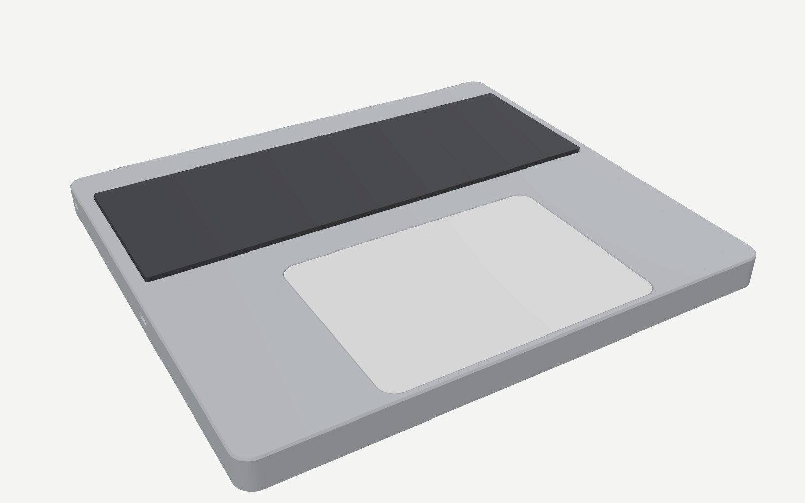
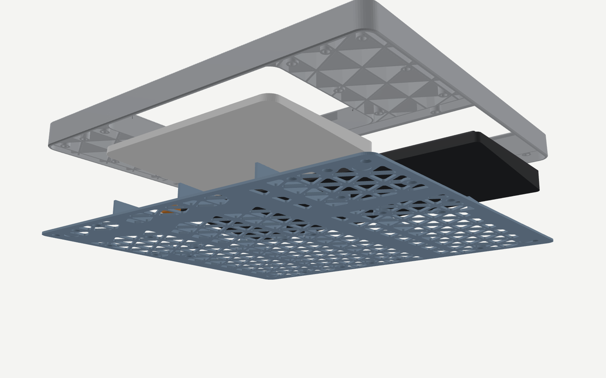
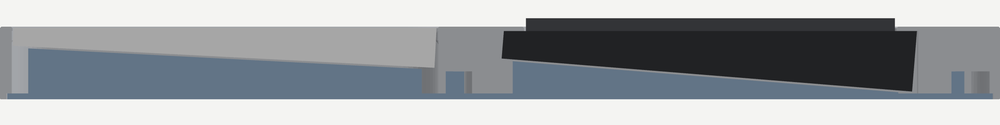
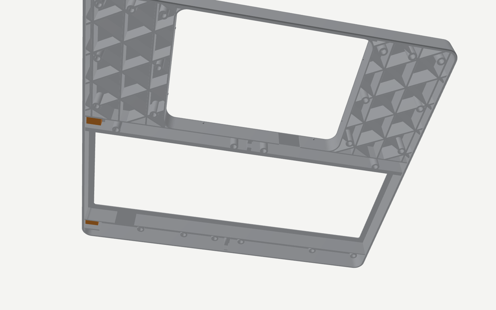
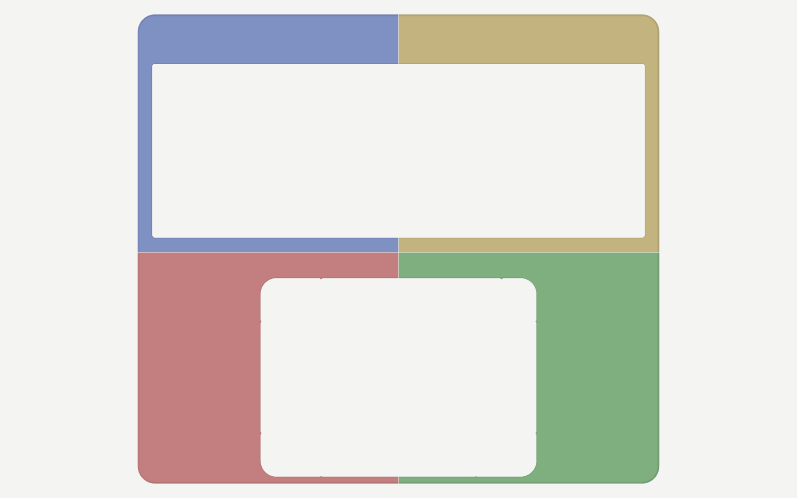
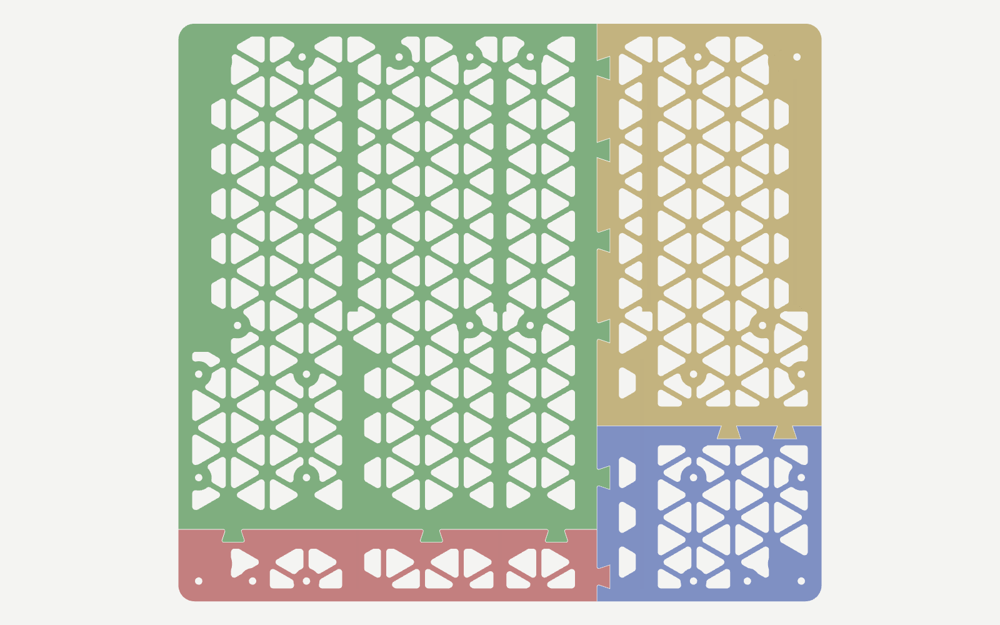
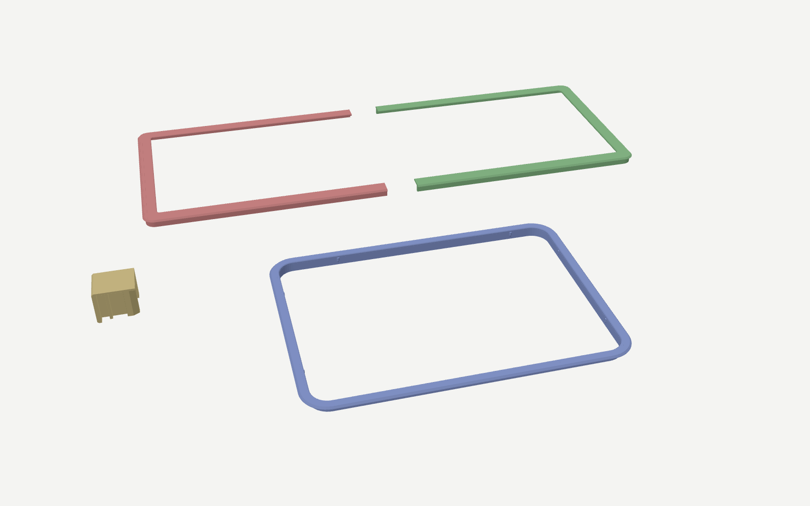

# Joro + Magic Trackpad 主板 v9：改动说明

> 接 [v8 交接文档](v8_handoff.md)。单位 mm，坐标系不变：x 向右，y 向后（y=0 是前缘），z 向上（z=0 是桌面）。
> 本文所有数字都来自 `cad/check.py` 的输出（完整报告见 [check_v9.txt](check_v9.txt)）。



## 1. 这一版做了什么

1. **换成真正的 CAD 内核**（v8 待办 A）。用 build123d（OpenCascade B-rep）重写，直接输出 STEP，可以在 Shapr3D 里编辑。
   - 所有边都是锐利的，圆角是精确的圆弧，不再有 0.4 mm 体素造成的小倒角。
   - 整个流程约 50 秒：建模、分块，再导出 STEP、STL 和 3MF。
2. **修正了 v8 的 6 个几何问题**（见第 2 节）。其中两个会导致装不上或用不了。
3. **接缝**（待办 B）。上壳默认用直缝，缝位和 v8 相同，都藏在开口里，缝下面加了加强结构；另外提供燕尾缝选项。底盖一律用燕尾拼图缝，各缝错开，只有 T 形交汇。
4. **USB-C 母座改成机械固定**（待办 D）。上壳做了夹座，底盖装上时会同时把母座锁住，不用再靠胶。
5. **试配件**（待办 G）。键区框（分左右两块）、触控板口、USB 座角各一个，都很小，可以先打出来验证实测参数。
6. **自动校验**（`check.py`）。检查设备干涉、间隙、键帽露出量、母座位置、每块的尺寸、每块是否为单一实体，以及每个螺丝柱是否只落在一块上。

## 2. 发现并修正的 v8 问题

| # | v8 的问题 | 后果 | v9 的处理 |
|---|---|---|---|
| 1 | **触控板没有任何固定**。面板开口 = 外形 + 0.3，触控板上方没有任何压边。 | 主板翻过来时触控板会从顶面掉出去；玻璃高度只取决于支撑条高度和泡棉压缩量，"下沉 0.3" 没法保证。 | 口袋壁四周共 8 条**压溃筋**，过盈 0.15，夹住触控板侧面，前后筋已经按倾斜侧面修正过。口袋后面补上了墙，中间留 20 mm 宽的插头槽。装配时用 0.3 mm 垫片定高（见第 6 节）。 |
| 2 | **键盘槽深度不够**。Joro 倾斜 4.6° 后，平面投影深度是 112.96，不是 112；v8 的槽深 112.8 已经包含了间隙。 | 后上棱处干涉约 0.56，键盘推不到位。 | 槽深按倾斜后的实体包络计算：112.96 + 2 × 0.4。 |
| 3 | 触控板倾斜 3° 后，前下棱比玻璃边缘前凸 0.26，而 v8 口袋壁到玻璃只有 0.3。 | 余量只剩 0.04。 | 口袋壁到玻璃改为 0.5（`TP_RING_CLR`）。面板开口仍是 0.3，所以从上面看到的缝不变。 |
| 4 | **后部 USB-C 母座放不下**。后区只有 9.4 宽，而母座金属壳本身就有 8.94 宽，后面的模块本体放不进去；而且开口（y 247–257）落在 R10 圆角上。 | 这个座子做不出来。 | 后区深度按母座尺寸自动计算，横装需要 22.8，开口落在侧面平直段上。代价是 D 从 259.3 增加到 273.2（第 4 节有更短的选项）。 |
| 5 | 上壳的 y 接缝刚好穿过隔筋上的 4 个螺丝柱。 | 螺丝柱和热熔螺母孔都被劈成两半。 | 重新排布螺丝柱，`check.py` 会逐个确认每个柱只属于一块。 |
| 6 | 底盖半搭接的上半层是 6 mm 宽、0.8 厚的**悬空悬垂**，正放打印时下面没有支撑。 | 会塌丝或下垂。 | 底盖改成燕尾拼图缝，所有接合面都是竖直的，没有悬垂。 |

## 3. 结构



剖面（x = W/2 处，穿过中间那根支撑条）：顶面水平；触控板和 Joro 都斜放，压在斜面支撑条上；键帽露出顶面。



- **总尺寸 W 303.6 × D 273.2 × H 19.75**。H = 面板 1.2 + Joro 倾斜后的竖直高度 16.44 + 泡棉 0.5 + 底盖 1.6。
- 上壳内部（从下往上看）：

  

  - 两侧掌托：三角点阵筋，筋厚 1.6，周期 24。
  - 触控板口袋壁：厚 1.2，带 8 条压溃筋，后墙中间开插头槽。
  - 走线槽：宽 11.6，前后分别是口袋后墙和隔筋。
  - 隔筋：厚 4.0，接缝就在它的中线上。
  - 键盘后墙：开有插头槽。
  - 后区：深 22.8，放第二个母座和键盘的走线。
  - 中线上加了两块 4 mm 隔板，一块在走线槽里，一块在后区，作为 x 接缝的粘接面；底部开 6 mm 的过线缺口。
- **螺丝**：24 个 M3 热熔螺母（Ø4.2 × 6），底盖用 M3 沉头螺丝固定。每块上壳至少 3 个，每块底盖至少 3 个。
- **体积**：上壳 200 cm³，底盖 87 cm³，PETG 实心约 365 g。
  - 比 v8 多约 60 g，来源是 D 增加 14 mm、口袋后墙、隔板、母座夹座，以及底盖接缝两侧的实心带。
  - 实际打印重量取决于切片设置。这些零件大多只有 1.2–2.4 mm 厚，基本都是实心打印。
  - 成品加上两个设备约 0.97 kg。

### 母座夹座

1. 侧壁在母座位置从内侧减薄到 1.2，母座的金属壳穿出来后正好和外表面齐平。
2. 两侧有夹板，上方有顶板。
3. 底盖上对应位置有托块（垫 1 mm 泡棉）和叉形挡片。挡片挡住母座后面，线从叉口中间穿出。

安装时插头方向的推力由挡片承受，拔出方向的力由侧壁承受，所以不需要胶。母座模块的尺寸见 `SOCK_BODY`，**必须按实际买到的模块修改**。

## 4. 两个需要你决定的取舍

**A. 上壳接缝样式 `SEAM_STYLE`**

| | `"straight"`（默认） | `"dovetail"` |
|---|---|---|
| 顶面能看到的 | 和 v8 一样：中线在触控板口前后各剩一小段，键区前后各剩一小段，另有一条横缝在触控板和键盘之间 | 一条 134 mm 长的竖缝穿过左掌托，缝上有燕尾凸起；横缝上也有凸块轮廓 |
| 连接方式 | 胶接（隔筋每侧 2 mm 和隔板都是粘接面），再由底盖错缝 + 缝两侧的螺丝桥接 | 燕尾互锁，不用胶也能定位；后块的凸耳里带螺丝柱 |
| 打印风险 | 对第一层象脚（外扩）和挤出过量都不敏感 | 燕尾配合间隙只有 0.125/侧；顶面朝下打印时，第一层的象脚会让缝合不严 |
| 分块尺寸 | 4 块都是 151.7 宽 | 右前块 247.5 宽，离 256 床边很近 |

我的判断：你最看重手感和外观，所以默认用 straight。粗算一下：捏住前缘单手拿起时，后半部分（约 0.45 kg，力臂约 60 mm）在面板接缝上产生的拉力只有约 15 N 量级，胶接加底盖桥接已经足够。这是手算量级，不是仿真结果。

**B. 母座方向 `SOCK_ORIENT`**

| | `"h"`（默认，横装，和笔记本一样） | `"v"`（竖装） |
|---|---|---|
| 后区深度 | 22.8 | 17.8 |
| 整机 D | 273.2 | 264.4（同时设 `KB_SKIN=0.8` 时） |

如果你愿意把键盘的充电口改到**背面直通**（在后壁上开一个插头大小的孔，直接插到 Joro 上），后区可以回到约 13，D 约 262。但这样口在背面，并且要准确知道 Joro 的口在哪里，所以没有做成默认。

试其他组合不用改文件：

```bash
DECK_PARAMS='{"SEAM_STYLE":"dovetail"}' python cad/check.py
DECK_PARAMS='{"KB_SKIN":0.8,"SOCK_ORIENT":"v"}' python cad/build.py
```

这三种组合（默认、dovetail、`KB_SKIN=0.8` + 竖装）都已经跑过 `check.py`，全部通过。

## 5. 分块

| 零件 | 打印尺寸 | 打印朝向 |
|---|---|---|
| 上壳 左前 / 右前 | 151.7 × 134.5 × 19.7 | 顶面朝下 |
| 上壳 左后 / 右后 | 151.7 × 138.4 × 19.7 | 顶面朝下 |
| 底盖 左前 | 200.1 × 33.3 × 13.8 | 底面朝下 |
| 底盖 左后 | 200.1 × 240.5 × 12.8 | 底面朝下 |
| 底盖 右前 | 104.1 × 81.3 × 13.8 | 底面朝下 |
| 底盖 右后 | 104.1 × 192.5 × 10.3 | 底面朝下 |

每块都在 250 × 250 以内（256 床，四边各留 3 mm），都是单一实体，网格封闭。接缝两侧共留 0.25 间隙（每侧 0.125）。

 

（上图是上壳从上往下看；下图是底盖，三条缝错开，只有 T 形交汇。）

## 6. 打印与装配

1. **先打试配件**（`out/print/joro_deck_v9_fit_test.3mf`，4 件，加起来不到 25 g）：

   

   - 键区框放在 Joro 上：
     - 键帽四周的缝应该均匀；
     - 每个键按到底时，键帽仍然高出框面；
     - 下沿围边能套住 Joro 的外轮廓。
   - 触控板框翻过来：放在桌上，玻璃下面垫 0.3 mm 垫片，把触控板从背面压进去。检查是否夹得住、四周缝是否均匀。
   - USB 座角：把母座插进去，检查金属壳是否与外表面齐平。

   有不对的地方，改 `params.py` 里标了 `MEASURE` 的参数后重新生成。
2. **上壳**：
   1. 把 4 块顶面朝下放在平整的玻璃或台面上。
   2. 在接缝面上胶（PETG 推荐用环氧或 PETG 专用胶）。
   3. 夹紧，放到固化。这样顶面自然平齐。
3. 装 24 个 M3 热熔螺母。
4. **触控板**：
   1. 上壳保持顶面朝下。
   2. 在触控板开口处的台面上垫一张 0.3 mm 垫片（例如 0.3 mm 塑料卡片）。
   3. 把触控板玻璃朝下压进口袋，压溃筋会夹住它，玻璃面正好低于面板 0.3。
5. **键盘**：键帽朝下放进键盘槽，让铝上盖贴住面板。
6. 接线：
   - 母座模块的金属壳从内侧插进侧壁开口，本体落进夹座。
   - 线沿走线槽和后区布好，从隔板底部的缺口穿过。
   - 插好 90° 弯头。
7. **底盖**：
   1. 4 块拼好后上胶。
   2. 支撑条上贴泡棉：键盘用 0.5 mm EVA，触控板用 0.5 mm 双面泡棉胶。
   3. 盖上，拧 24 颗 M3 沉头螺丝。
   4. 贴 4 个 Ø10 脚垫。

## 7. 还需要实测的参数（`params.py` 里标了 `MEASURE`）

| 参数 | 当前值 | 怎么量 |
|---|---|---|
| `KB_FRONT_H` / `KB_ANGLE` | 7.49 / 4.6° | 卡尺量 Joro 前沿高度（不含键帽） |
| `KF_INSET` | 6, 6, 6, 6 | 外框边缘到最外侧键帽边缘的距离，左、右、前、后各量一次 |
| `KEYCAP_H` | 3.5 | 键帽顶面到铝上盖的高度。`check.py` 要求按到底后键帽仍高出面板 ≥ 0.3，当前算出来是 0.70 |
| `KB_R`、`KF_R`、`TP_R` | 4 / 2 / 9 | 圆角半径，可以用试配件对比 |
| `KB_PORT_X` | 40 | **评测说法不一致**：Macworld 和 Notebookcheck 说口在背面，Windows Central 说在右上角。这个参数只影响后墙插头槽的位置 |
| `TP_PORT_X` | 116 | 触控板 USB-C 口中心到左边缘的距离（从正面看） |
| `SOCK_BODY` | 11 × 6 × 14 | 你买的母座模块本体的宽 × 高 × 深 |

## 8. 仍然存在的风险

- **没有做受力仿真**（待办 E 里的 FEA）。结构判断仍然是按原理加手算量级。
- **Force Touch 的支撑方式没有验证**。目前是 3 根支撑条加泡棉托住底面，支撑条的位置（`tp_rails`）要对照触控板底部的脚垫调整。
- **触控板电源开关仍然被封在壳里**。
- **USB-C 母座**：夹座按通用尺寸设计，买到具体模块后必须改 `SOCK_BODY`。另外，母座的金属壳需要伸出模块本体正好 1.2（`SOCK_WALL`）才能与外表面齐平。
- **3MF 只有一个打印盘**，8 个零件并排摆放，需要在 Bambu Studio 或 Orca 里用"自动摆放"分盘。没有做 G-code，因为需要打印机型号和喷嘴直径。
- **设备模型都是简化的楔形包络**（直边加平面圆角），真实设备的边缘有倒圆，实际间隙会比模型略大。
